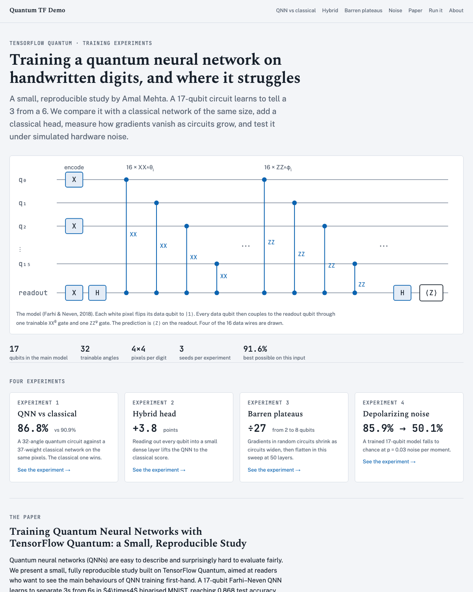
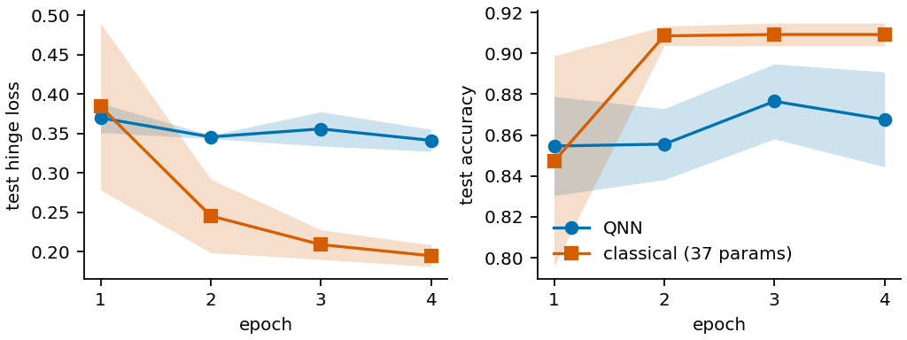
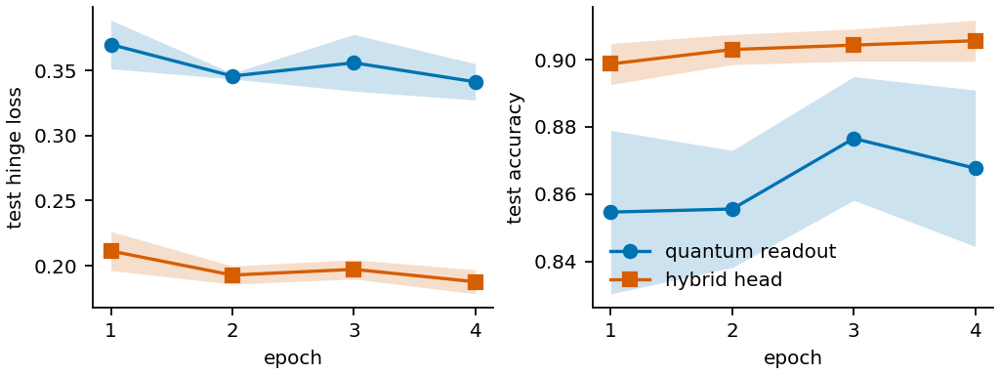
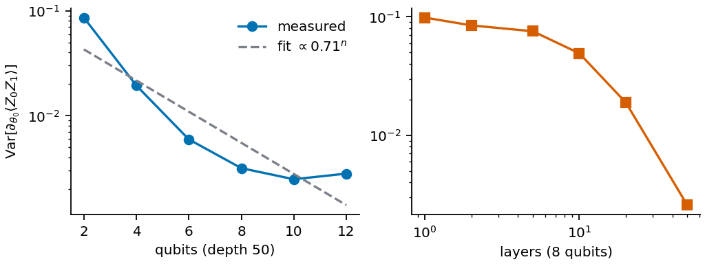
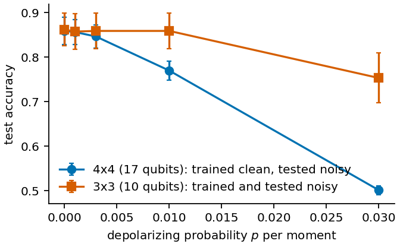

# Quantum TF Demo

A reproducible TensorFlow Quantum demo: a 17-qubit quantum neural network learns to tell a 3 from a 6,
compared with a classical network of the same size and a hybrid head, plus barren plateaus and
training under depolarizing noise.

| QNN vs classical | Quantum readout vs hybrid head |
|---|---|
|  |  |
| **Barren plateaus** | **Depolarizing noise** |
|  |  |

## Links

- [Website](site/public/index.html): serve it with `python3 -m http.server --directory site/public`, or host `site/public/` anywhere
- [Paper (PDF)](paper/arxiv/main.pdf)
- [Notebook walkthrough](notebooks/Quantum%20TF%20Demo.ipynb)
- [Instructions: setup, run, use](docs/INSTRUCTIONS.md)
- [System design](docs/SYSTEM-DESIGN.md)
- [File structure](docs/FILE-STRUCTURE.md)
