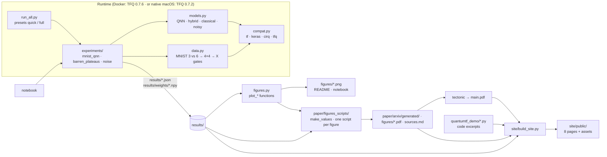

# System design

Quantum TF Demo is a batch pipeline: experiments write JSON, and three consumers (quick figures,
the paper and the site) read only that JSON. There is no server and no state beyond files.

## Architecture

## Components

| Component | Job |
|---|---|
| `quantumtf_demo/__init__.py` | Sets `TF_USE_LEGACY_KERAS=1` and `OPENBLAS_NUM_THREADS=1` before anything imports TensorFlow. |
| `compat.py` | One import point that hides the version split: `tf_keras` on TF ≥ 2.16, `tf.keras` on TF 2.7. |
| `data.py` | Loads MNIST, keeps 3s and 6s, downsamples to *k*×*k*, removes training images whose continuous downsampled form appears with both labels, binarises at 0.5, and encodes each lit pixel as an `X` gate on a `GridQubit`. |
| `models.py` | `qnn_circuit` builds the Farhi–Neven circuit (readout qubit, one `XX^θ` and one `ZZ^φ` per data qubit). The builders wrap it as a Keras model: `PQC` (exact), `NoisyPQC` (trajectories + parameter shift), a hybrid with ⟨Z⟩ on all qubits feeding Dense(8)→Dense(1), and a 37-parameter classical MLP. |
| `experiments/data_stats.py` | Training-set size after filtering, distinct binarised patterns, and the lookup-table ceiling (each training pattern predicts its majority label): 0.916 at 4×4, 0.840 at 3×3. |
| `experiments/mnist_qnn.py` | Experiments 1 and 2. For each seed, the same data split trains QNN, hybrid and classical models. It saves QNN weights for reuse. |
| `experiments/barren_plateaus.py` | Experiment 3. Random Ry/Rx/Rz + CZ-ladder circuits; variance of ∂⟨Z₀Z₁⟩/∂θ₀ (adjoint gradients) over random circuits and angles, swept over qubits and depth, plus a log-linear fit. |
| `experiments/noise.py` | Experiment 4. (a) Experiment 1's 4×4 QNNs tested under depolarizing noise *p* ∈ {0, 0.001, 0.003, 0.01, 0.03}. (b) 3×3 QNNs trained and tested with the noise present. |
| `run_all.py` | CLI and presets. `quick` checks the pipeline in minutes; `full` produces the paper's numbers. |
| `figures.py` | `plot_*` functions taking a results dict and a figure size. The README PNGs and the paper PDFs call the same functions. |
| `paper/figures_scripts/` | Paper build: `make_values.py` writes `\val…` macros, booktabs tables and `sources.md`. One script per figure calls `figures.plot_*` at the paper's exact width. |
| `site/build_site.py` | Builds the eight-page website in `site/public/`. Results go to `assets/data.js`, and `src/site.js` draws every chart in SVG from them (theme-aware, hover values, a per-seed toggle). Prose numbers come from the results or from the paper's `values.tex`. `paper.html` is converted from the LaTeX sections, with section, figure and table numbers matching the PDF, citations numbered as in plainnat, and math rendered by MathJax (SVG output, no external fonts). Code excerpts are pulled from the source with `ast`, using real line numbers. |

## Main flows

1. **Experiment run.** `run_all --preset full` → `data_stats` → `mnist_qnn` (saves weights) → `barren_plateaus`
   → `noise` (loads the weights). Each writes `results/<name>.json` holding its config, library
   versions, per-seed histories and a mean ± std summary.
2. **Paper build.** `make_all.py` → `make_values.py` + figure scripts → `tectonic main.tex`. No number
   is typed into the prose: `check_paper.py --regenerate` re-runs the scripts and fails if any
   output changes.
3. **Site build.** `build_site.py` → `site/public/` (full HTML documents) and, with `--fragment`, a
   body-only copy of the home page for hosts that add their own `<head>` (the private claude.ai page).

## Where data lives

| Data | Location | Written by |
|---|---|---|
| MNIST | `~/.keras/datasets/mnist.npz` (Docker: mount `.cache/keras`) | Keras on first use |
| Results | `results/*.json` | experiments |
| Trained QNN angles | `results/weights/qnn_seed*.npy` | `mnist_qnn` |
| Logs | `results/logs/*.log` | shell redirect in the Docker commands |
| Paper numbers | `paper/arxiv/generated/`, `paper/arxiv/sources.md` | `make_values.py` |

## Key decisions and trade-offs

- **Docker on TFQ 0.7.6 as the main runtime.** The only native macOS wheels are TFQ 0.7.2 / TF 2.7
  (2021, Intel only). They work after three workarounds (wheel retag, single-threaded BLAS, conda
  Python), but they import slowly and trained about 4× slower here. *Trade-off:* a 3 GB image, and
  the native route stays documented and tested as the fallback.
- **The hybrid model shares Experiment 1's data and seeds.** The QNN is trained once and compared
  against both alternatives on identical splits. *Trade-off:* Experiments 1 and 2 share one results file.
- **Noise at two scales.** Noisy training needs parameter-shift gradients through trajectory
  simulation (about 65 noisy circuits per image). At 17 qubits this was about 400 s per 64 images per
  epoch, so noisy *training* uses 3×3 images (10 qubits), while noisy *evaluation* uses the real 4×4
  models. *Trade-off:* the two curves are different models, and the site and paper say so.
- **Contradiction removal before binarising**, matching the TFQ tutorial. Doing it after
  binarising (the first version) discarded about 70% of the training set and capped test accuracy
  near 0.63. A lookup table over all binarised 4×4 training patterns reaches 0.916 test accuracy,
  which is the ceiling for any model on this input.
- **Hinge loss on ±1 labels**, as in Farhi & Neven: ⟨Z⟩ ∈ [−1, 1] maps directly to a margin.
- **Hyperparameters** (batch 32 / learning rate 0.01 at 4×4; batch 16 / 0.02 for the 3×3 noise
  training) were picked from a two-setting sweep on seed 0 (`.cache/tune.py`, not committed). That
  is light tuning, and the paper says so.
- **Every number traceable.** Results JSON → macros → `sources.md`. The site reads the same JSON and the same macros.
- **The website is static, with a small hand-written LaTeX converter.** No Pandoc or site generator
  is needed, just the standard library. *Trade-off:* it only handles the LaTeX subset the paper uses, so new
  constructs (e.g. `\begin{equation}`) need a converter rule.
- **Home links use `./`, not `index.html`,** because the claude.ai host serves the home page at its
  root. *Trade-off:* opening `site/public/index.html` straight from disk makes "Home" show the folder,
  so serve the folder over HTTP instead.

## Testing

- `tests/test_demo.py` (10 tests, ~1 min in Docker, ~3 min native): encoding, contradiction
  removal, label mapping, circuit parameter count, exact parameter counts for all three models, a
  QNN that lowers its loss on a learnable toy task, a noisy layer giving bounded outputs, and
  gradient variance shrinking from 2 to 8 qubits.
- Tested on both TFQ 0.7.2 (native) and 0.7.6 (Docker).
- `--preset quick` is the end-to-end smoke test: every experiment, figure and value path.
- Notebook: executed end to end with `jupyter nbconvert --execute` in Docker.
- Site: every page loaded in a browser over HTTP and checked for console errors, horizontal overflow,
  undrawn charts, MathJax errors (76 expressions, none failed) and broken in-page anchors. The seed
  toggle was checked by DOM count.
- Paper: `check_paper.py` (LaTeX errors, undefined references, sourced numbers, figure scripts,
  regeneration, citations checked against arXiv and Crossref).

## Known limits

- Simulation only: no quantum hardware. Training time reflects CPU state-vector simulation.
- Barren plateaus: variance stops falling beyond 8 qubits at 50 layers. Probably too shallow for
  the wider circuits, but not tested.
- Noise: the noisy-training curve (3×3) can't be compared directly with the 4×4 evaluation curve.
- Small scale: 4×4 binarised images, two digits, 3 seeds, a few epochs. These results illustrate
  known phenomena; they don't establish new ones.
- The noisy-training study is at 3×3 and uses 50 trajectories per expectation, so every noisy
  output carries trajectory-sampling noise (shrinking as 1/√trajectories) on top of the channel itself.
- Hyperparameters were lightly tuned on seed 0 only.
- Native macOS route: Intel only, slow imports, and TFQ 0.7.2 is unmaintained.
